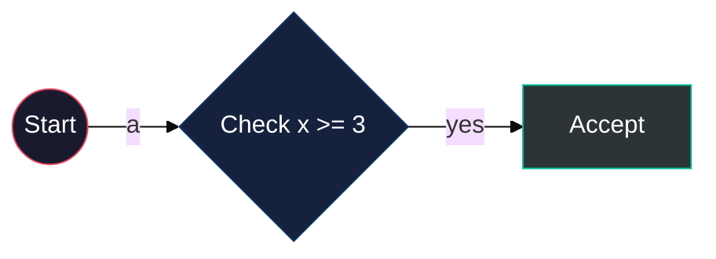

# Lecture Style Guide (merc, lecture edition)

*Adapted from doc-merc-v4 (copied 2026-11-14); maintained independently.*

Lecture conversions are **faithful**: formatting only, never new content. Keep the slide's words. Exceptions: the optional Key Idea callout (section 4) and the figure blocks already written by the vision step.

## 1. Document skeleton and ToC

````markdown
> Source: Lec03.pdf — instructor slides, converted to Markdown. Figure blocks marked "AI transcription" are AI-written; check the linked image for exact details.
# Lexical Analysis 2
### CMPS403 Compilers — Lecture slides

## Table of Contents

1. [Finite Automata](#part-1)
   - [05 · What is an NFA](#s05)
   - [06 · NFA example](#s06)
2. [Regex to NFA](#part-2)
   - [07 · Thompson construction](#s07)

<a id="part-1"></a>
## PART 1 — Finite Automata

<a id="s05"></a>
### 05 · What is an NFA

- Nondeterministic: several moves per input symbol

---

<a id="part-2"></a>
## PART 2 — Regex to NFA

...

---
*Scope: Lexical Analysis 2 · 41 slides · converted from Lec03.pdf*
````

Rules:
- Only one `#` (the title). PARTs are `##`, slides are `###` with `NN` = 2-digit slide number. No emoji in headings.
- Anchor `<a id=...></a>` on its own line directly above its heading. Never rely on auto-slugs (renderers differ).
- ToC: PART links `#part-N`, slides nested 3 spaces deep as `#sNN`. Every link must hit an existing anchor.
- `---` goes only between PARTs (plus before the footer). Never between slides.

## 2. Tables

Mechanical triggers (not a judgment call), always with the slide's own words:
- **>=2 items x >=2 shared attributes** -> comparison table, first column bold.
- **>=3 structured records** (tokens, instructions, opcodes, parameters) -> reference table.

Before:
```text
Token: IF   Lexeme: if      Pattern: the letters i f
Token: ID   Lexeme: count   Pattern: letter (letter|digit)*
Token: NUM  Lexeme: 42      Pattern: digit+
```
After:
````markdown
| **Token** | **Lexeme** | **Pattern** |
|---|---|---|
| **IF** | `if` | the letters i f |
| **ID** | `count` | `letter (letter\|digit)*` |
| **NUM** | `42` | `digit+` |
````
- Inside table cells a literal pipe is always `\|`, even inside backticks.
- Every row has the same number of cells as the header.

**Merged cells or multi-tier headers (and only then)**: use HTML `<table>` with `<thead>`, `<tbody>`, `colspan`, `rowspan`.

````markdown
<table>
<thead>
<tr><th rowspan="2">Instr</th><th colspan="2">Cycles</th></tr>
<tr><th>Single</th><th>Pipelined</th></tr>
</thead>
<tbody>
<tr><td>lw</td><td>5</td><td>1</td></tr>
</tbody>
</table>
````

**Footnotes and legends** never become fragmented trailing rows (`| * | note | | |`). Move them under the table:

````markdown
> **Notes & Footnotes**
> - \* Applies to the unpipelined design only.
````

## 3. Formatting that adds no words

- Bullets are `-`; sub-points nest by 2 spaces. Turn `•`, `–`, `o` into `-`.
- Bold the term being defined, only when the slide itself defines it: `**Token**: a pair of name and attribute value`. Do not bold anything else for emphasis.
- A slide line that already starts with `Note:`, `Important:` or `Remember:` may be wrapped in a callout, keeping its exact words:

````markdown
> [!IMPORTANT]
> Remember: the longest match wins.
````
  Use `[!NOTE]` for `Note:` lines. Do not turn other lines into callouts.
- Code always gets a language fence (`c`, `python`, `text`, `asm`, `bash`). Pseudo-grammar or unknown: `text`.
- Blank line between every block (paragraph, list, table, fence, callout).

## 4. AI Key Idea callout (optional, at most 1 per PART)

Exact form, directly under the `## PART` heading and BEFORE the PART's first `<a id="sNN">`:

````markdown
<a id="part-2"></a>
## PART 2 — Regex to NFA

> [!TIP]
> **Key Idea (AI-added):** Thompson construction builds an NFA for a regex piece by piece, joining small NFAs with epsilon moves.

<a id="s07"></a>
### 07 · Thompson construction
````
- Maximum 1 per PART; a PART with nothing worth summarising gets none.
- 1-2 sentences (under 60 words), summarising ONLY what that PART's slides say. No new facts, examples or analogies.
- Never inside a slide, never replacing slide text, never a PART intro or summary.
- Do not confuse it with figure blocks: those are `> [!NOTE]` + `**Figure — AI transcription**` and must be left exactly as written:

````markdown
> [!NOTE]
> **Figure — AI transcription** (slide 07)

State 0 --a--> State 1 ...

````
The transcription content and image line stay outside the blockquote. Never shorten them.

## 5. Mermaid (renderer-safe subset)

Why: preview tools (VS Code, Obsidian) bundle older Mermaid versions; a diagram that compiles can still render as raw code. Style and syntax only; never change nodes or edges.

Rules:
- First line inside the block: `%%{init: {'theme':'base'}}%%`.
- Edge labels only `A -->|x| B` or `A -.->|x| B`. Not `A -- x --> B`, not `A -- "x" --> B`.
- Shapes only `["..."]`, `("...")`, `(("..."))`, `{"..."}`. Never stadium `([...])`.
- All labels double-quoted, plain ASCII: no emoji, no Unicode arrows or symbols (write `->`, `>=`, `<=`, `!=` instead of the glyphs), "and" for `&`, no `|` inside labels, a space around `<` and `>`. Multiline labels use `<br/>`.
- Style with `classDef` and `:::class`. No nested subgraphs, never `style` a subgraph id.

Roles (add the classDefs you use, assign by what the node is):

| Class | Definition | Use for |
|---|---|---|
| `entry` | `classDef entry fill:#1a1a2e,stroke:#e94560,color:#fff` | inputs, start |
| `core` | `classDef core fill:#16213e,stroke:#0f3460,color:#fff` | processing, logic |
| `data` | `classDef data fill:#0f3460,stroke:#533483,color:#fff` | memory, registers, storage, tables |
| `out` | `classDef out fill:#2d3436,stroke:#00b894,color:#fff` | results, outputs, accept states |
| `ext` | `classDef ext fill:#2d3436,stroke:#6c5ce7,color:#fff` | control, external |

Before:
```text
S([Start]) -- "a" --> Q1{Check x ≥ 3}
```
After:
````markdown

````

## 6. LaTeX math

Trigger: fractions, sums/integrals, roots, sub/superscripts, Greek letters, matrices, multi-step derivations. Trivial (`n = 5`, `O(n)`) stays plain or `code`.
- Inline: `$CPI = \frac{cycles}{instructions}$`.
- Block `$$...$$` on their own lines, top level only. Inside callouts, lists or blockquotes use a ```` ```math ```` fence.
- Literal dollar signs are escaped `\$`.
- Table cells: never a bare `|` in math; use `\lvert x \rvert`, `\mid`.
- No LaTeX in Mermaid labels.
- **Regex and grammar notation is not math.** `a|b`, `(a|b)*`, `E -> E + T` go in backticks, never in `$...$`, and inside a table cell the pipe is escaped `\|`.

Before / after:
````markdown
Execution time = Instruction count x CPI x Clock cycle time

$$
T_{exec} = IC \times CPI \times T_{clk}
$$

Regex: (a|b)* abb   ->   Regex: `(a|b)*abb`
````
Convert only formulas the slide itself states; keep its wording and symbols.

## 7. ASCII art

Only small trees, without a right-hand border. Bordered boxes are retired; use a list or table instead.

````markdown
```text
Program
├── Declarations
└── Statements
```
````

## 8. Not used in lectures

- Collapsible `<details>`: slides are the primary content; nothing is hidden.
- `block-beta`: beta renderer support, same reason as the Mermaid subset.
- Decision/options framework and the concept-intro pattern (problem / does / analogy): they add content the slides do not contain.
- Task lists, footnote references (`[^1]`), emoji.
- PART intros and PART summaries. The single Key Idea callout (section 4) is the only AI-written text allowed besides figure blocks.
