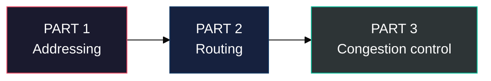
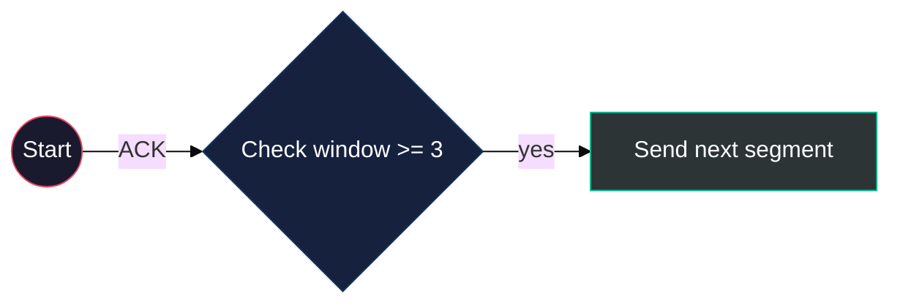

# Lecture Style Guide (merc, lecture edition)

*Adapted from doc-merc-v4 (copied 2026-11-14; v4.1, 2026-11-14: topic subsections); maintained independently.*

Lecture conversions are **faithful**: formatting only, never new content. Keep the slide's words. The only AI-written additions are the Key Idea callout (section 8), the Roadmap (section 9) and the figure blocks already written by the vision step.

## 1. Document skeleton

````markdown
# <TITLE>
### <descriptive subtitle: what the lecture covers>

> **Source:** `<pdf name>` (<N> slides) · <instructor / course / date facts from the title slide>
> **Conversion note:** slide text is the instructor's; blocks marked "AI transcription" or "AI-added" are AI-written — check the linked image / the PDF for exact details.

## Table of Contents
- [PART 1 — <topic>](#part-1) *(slides 4–9)*
  - [1.1 <subtopic>](#part-1-1) *(slides 4–5)*
  - [1.2 <subtopic>](#part-1-2) *(slide 6)*
- [PART 2 — <topic>](#part-2) *(slides 10–20)*

### Roadmap (AI-added)
```mermaid
%%{init: {'theme':'base'}}%%
flowchart LR
  ... one node per PART ...
```

---

<a id="part-1"></a>
## PART 1 — <topic>

> [!TIP]
> **Key Idea (AI-added):** 1-2 sentences, optional.

<a id="part-1-1"></a>
### 1.1 <subtopic> (slides 4–5)

<a id="s04"></a>
- slide 4 text verbatim

> [!NOTE]
> **Figure — AI transcription** (slide 04)

...transcription...


<a id="s05"></a>
- slide 5 text

---
(next PART ...)

---
*Scope: <TITLE> · <N> slides · converted from <pdf>*
*Dropped slides: 01 (title), 02 (outline), 03 (section divider), 73 (end)*
````

Rules:
- One `#` (the title), then the `###` subtitle as the next non-empty line. PARTs are `##`, subsections `###`. No emoji in headings.
- Never rely on auto-slugs (renderers differ): every anchor is an explicit `<a id="..."></a>` on its own line directly above its heading (or, for slides, above the slide's content).
- ToC: PART links `#part-N`, subsections nested 2 spaces as `#part-N-M`, each with its slide range in italics. Every link must hit an existing anchor.
- `---` goes only between PARTs (plus before the footer). Never between subsections or slides.
- Footer has two lines: `*Scope: ...*` and `*Dropped slides: ...*` (`none` is allowed, a missing line is not).

## 2. Dropped slides

Dropped slides get no anchor and are listed in the footer, each with a short reason. Drop only:
- the title slide (its facts go to the `> **Source:**` line),
- course outline / agenda slides,
- section-divider slides whose only content is a section name (the name becomes a PART or subsection title),
- thank-you, acknowledgment, questions or references-only slides.

The raw file marks such slides with an INJECT block whose content starts with `drop:` (e.g. `drop: section divider — Parsing`, `drop: title slide — Course X · Part 1 · Dr. Y`). Use that text: the title-slide text feeds the `> **Source:**` line, a divider's name becomes the PART/subsection title; then drop the slide. No image link is needed for `drop:` blocks.

**Never drop a slide that teaches anything**, even if it looks sparse. When unsure, keep it.

## 3. Subsections and hidden slide anchors

A subsection is a run of consecutive slides on one sub-topic.
- Heading `### N.M Title (slides a–b)` or `### N.M Title (slide a)`; `<a id="part-N-M"></a>` right before it.
- Every kept slide has exactly one hidden `<a id="sNN"></a>` (2-digit number) on its own line before that slide's content. Anchors are unique, in slide order, and sit inside the subsection whose range contains them.
- Every kept slide sits inside some subsection; a PART may hold one or several.
- Slide titles are not headings any more: they feed the subsection title. Don't repeat them in the body.

## 4. Repeated lines (progressive builds)

Slides often repeat earlier lines while adding one more. Within one subsection, a text line identical to an earlier one is written once (at its first appearance). Every figure from every build is kept, in order, because figures can differ even when text repeats.

## 5. Lean figures

- No filler lines: never write "Slide use:", "Title slide, text only", "No figure content".
- Decorative figures (`skip` in the raw file) are dropped silently.
- A figure that is pure text or a formula and is fully written out in the body may be reduced to just its image link (no NOTE block). Every non-skip figure still needs its `<id>.png` link.
- Otherwise keep the full block exactly as the vision step wrote it; never shorten the transcription:

````markdown
> [!NOTE]
> **Figure — AI transcription** (slide 07)

Client --SYN--> Server

````
The transcription and image line stay outside the blockquote.

## 6. Tables

Mechanical triggers (not a judgment call), always with the slide's own words:
- **>=2 items x >=2 shared attributes** -> comparison table, first column bold.
- **>=3 structured records** (tokens, instructions, packet fields, parameters) -> reference table.
- **>=3 "label: explanation" pairs** -> two-column table (`Term | Explanation`).
- **A formula followed by symbol definitions** -> keep the formula, then a `Symbol | Meaning` table under it.

Before:
```text
Protocol: TCP   Ordering: yes   Loss recovery: retransmit
Protocol: UDP   Ordering: no    Loss recovery: none
```
After:
````markdown
| **Protocol** | **Ordering** | **Loss recovery** |
|---|---|---|
| **TCP** | yes | retransmit |
| **UDP** | no | none |
````

Symbol legend example (statistics / ML):
````markdown
$$
\hat{y} = w^{T}x + b
$$

| Symbol | Meaning |
|---|---|
| $\hat{y}$ | predicted value |
| $w$ | weight vector |
| $b$ | bias term |
````

- Inside table cells a literal pipe is always `\|`, even inside backticks (e.g. `` `letter (letter\|digit)*` ``).
- Every row has the same number of cells as the header.
- **Merged cells or multi-tier headers (and only then)**: HTML `<table>` with `<thead>`, `<tbody>`, `colspan`, `rowspan`.

- **Footnotes and legends** never become fragmented trailing rows (`| * | note | | |`); move them under the table as a `> **Notes & Footnotes**` blockquote.

## 7. Formatting that adds no words

- Bullets are `-`; sub-points nest by 2 spaces. Turn `•`, `–`, `o` into `-`.
- Bold the term being defined, only when the slide itself defines it: `**Overfitting**: the model fits noise in the training data`. Do not bold anything else for emphasis.
- A slide line that already starts with `Note:`, `Important:` or `Remember:` may be wrapped in a callout, keeping its exact words (`[!NOTE]` for `Note:`):

````markdown
> [!IMPORTANT]
> Remember: the longest match wins.
````
- Code always gets a language fence (`c`, `python`, `text`, `asm`, `bash`). Pseudo-grammar or unknown: `text`.
- Blank line between every block (paragraph, list, table, fence, callout).

## 8. AI Key Idea callout (optional, at most 1 per PART)

Placed between the `## PART` heading and the PART's first subsection anchor `<a id="part-N-1">`:

````markdown
## PART 2 — Cache memory

> [!TIP]
> **Key Idea (AI-added):** A cache keeps recently used blocks close to the CPU, so most accesses avoid slow main memory.

<a id="part-2-1"></a>
````
- 1-2 sentences (under 60 words), summarising ONLY what that PART's slides say. No new facts, examples or analogies.
- Never inside a subsection, never replacing slide text, never a PART intro or summary. A PART with nothing worth summarising gets none.
- Do not confuse it with figure blocks (`> [!NOTE]` + `**Figure — AI transcription**`), which are left exactly as written.

## 9. Roadmap (AI-added)

- At most one, headed exactly `### Roadmap (AI-added)`, after the ToC and before `<a id="part-1">`, followed by one mermaid block.
- Built only from PART (optionally key subsection) titles: no new facts, no invented links between topics beyond the order of the PARTs.
- Plain `flowchart LR`, one node per PART, edges in lecture order. Keep labels short (shorten titles, never reword their meaning).
- Safe Mermaid subset (section 10) and role classDefs apply.

````markdown

````

## 10. Mermaid (renderer-safe subset)

Why: preview tools (VS Code, Obsidian) bundle older Mermaid versions; a diagram that compiles can still render as raw code. Style and syntax only; never change nodes or edges. Diagram direction (`LR`, `TD`, ...) simply follows how the slide draws it.

Rules:
- First line inside the block: `%%{init: {'theme':'base'}}%%`.
- Edge labels only `A -->|x| B` or `A -.->|x| B`. Not `A -- x --> B`, not `A -- "x" --> B`.
- Shapes only `["..."]`, `("...")`, `(("..."))`, `{"..."}`. Never stadium `([...])`.
- All labels double-quoted, plain ASCII: no emoji, no Unicode arrows or symbols (write `->`, `>=`, `<=`, `!=`), "and" for `&`, no `|` inside labels, a space around `<` and `>`. Multiline labels use `<br/>`.
- Style with `classDef` and `:::class`. No nested subgraphs, never `style` a subgraph id.

Roles (add the classDefs you use, assign by what the node is):

| Class | Definition | Use for |
|---|---|---|
| `entry` | `classDef entry fill:#1a1a2e,stroke:#e94560,color:#fff` | inputs, start |
| `core` | `classDef core fill:#16213e,stroke:#0f3460,color:#fff` | processing, logic |
| `data` | `classDef data fill:#0f3460,stroke:#533483,color:#fff` | memory, registers, storage, tables |
| `out` | `classDef out fill:#2d3436,stroke:#00b894,color:#fff` | results, outputs, accept states |
| `ext` | `classDef ext fill:#2d3436,stroke:#6c5ce7,color:#fff` | control, external |

Example, rewriting `S([Start]) -- "ACK" --> Q1{Check window ≥ 3}`:
````markdown

````

## 11. LaTeX math

Trigger: fractions, sums/integrals, roots, sub/superscripts, Greek letters, matrices, multi-step derivations. Trivial (`n = 5`, `O(n)`) stays plain or `code`.
- Inline: `$CPI = \frac{cycles}{instructions}$`.
- Block `$$...$$` on their own lines, top level only. Inside callouts, lists or blockquotes use a ```` ```math ```` fence.
- Literal dollar signs are escaped `\$`.
- Table cells: never a bare `|` in math; use `\lvert x \rvert`, `\mid`.
- No LaTeX in Mermaid labels.
- **Regex and grammar notation is not math.** `a|b`, `(a|b)*`, `E -> E + T` go in backticks, never in `$...$`; inside a table cell the pipe is escaped `\|`.

Example: `Execution time = IC x CPI x Tclk` becomes `$$T_{exec} = IC \times CPI \times T_{clk}$$` (on its own lines); `(a|b)* abb` becomes `` `(a|b)*abb` ``.
Convert only formulas the slide itself states; keep its wording and symbols.

## 12. ASCII art

Only small trees or layouts, without a right-hand border. Bordered boxes are retired; use a list or table instead.

````text
Program
├── Declarations
└── Statements
````

## 13. Not used in lectures

- Collapsible `<details>`: slides are the primary content; nothing is hidden.
- `block-beta`: beta renderer support, same reason as the Mermaid subset.
- Decision/options framework and the concept-intro pattern (problem / does / analogy): they add content the slides do not contain.
- Task lists, footnote references (`[^1]`), emoji, PART intros and PART summaries. The Key Idea callout and the Roadmap are the only AI-written text allowed besides figure blocks.
