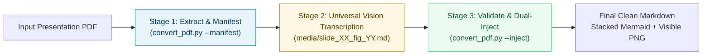
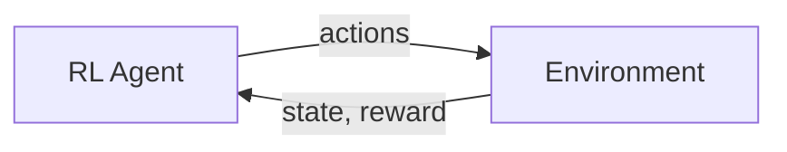

# convert-pptx-pdf2md-v1: Presentation PDF to Complete Markdown Converter
### docx2md-v3 Aesthetic Edition

**pptx-pdf2md-v1** is the specialized presentation ingestion engine for Gemini CLI, fully aligned with the **docx2md-v3** executive document standards. It guarantees 100% complete, visually stunning, and token-efficient Markdown representations of PDF lecture slides, technical decks, and academic presentations.

---

## 1. Key Innovations in pptx-pdf2md-v1

| Capability | Technical Mechanism | Benefit |
| :--- | :--- | :--- |
| **docx2md-v3 Executive Aesthetic** | Auto-parses title slides into structured metadata banners, Table of Contents, and formal List of Figures. | Produces publication-grade, professional study and specification documents. |
| **Universal Visual Evaluator** | Classifies every asset across the deck (`mermaid` vs `latex` vs `image`) and marks heavy photos/collages to skip wasteful diagram synthesis. | Zero token drain on photographic collages (Slide 42) while ensuring flowcharts (Slides 62, 63) are transcribed. |
| **Dual Visual Co-existence** | Renders Mermaid / LaTeX blocks directly stacked above the visible high-res PNG and formal sequential Figure caption (`**Figure N:** ...`). | Delivers both interactive text representations AND ground-truth original graphics side-by-side without hidden dropdowns. |
| **2D Spatial Canvas & Auto-Bolding** | Isolates corner slide numbers into metadata anchors (`### Slide X: [Title]`) and auto-bolds colon-separated lead-ins (`* **Term:** Detail`). | Unbroken visual hierarchy with high readability. |
| **Hybrid Raster + Vector Harvesting** | Intercepts bitmap raster streams AND merges neighboring vector drawing clusters (`margin_x=45pt, margin_y=25pt`) into unified 2.0x figures. | 100% diagram capture, even on decks with 0 raster images. |
| **Partitioned Manifest** | Emits `images_manifest.json` chunked into manageable batches ($\le 30$ items) with preceding/following slide bullet context. | Reliable, resumable agent vision transcription across long decks. |

---

## 2. Staged Conversion Lifecycle

pptx-pdf2md-v1 operates via a strict 3-stage handoff protocol:



---

## 3. Quick Start Workflows

### Workflow 1: Single File Conversion (Default)
Extracts all slides, harvests raster & vector visuals, and generates the docx2md-v3 styled Markdown and partitioned manifest:
```bash
python ~/.gemini/skills/convert-pptx-pdf2md-v1/scripts/convert_pdf.py <input_pdf_path> [output_md_path] --manifest
```

### Workflow 2: Stage 2 Universal Agent Vision Transcription
For visual assets flagged in `images_manifest.json`:
1. Read the manifest to inspect `batches.batch_1`, etc.
2. For each asset:
   - If `skip_diagram_synthesis: true` (e.g. photos, collages, complex screenshots like Slide 42): **Leave as-is** (do not create companion file). The engine will display the high-res PNG with its formal Figure caption.
   - If `transcription_target: "mermaid"` (e.g. flowcharts, state transitions, RL loops like Slides 62 & 63): Inspect image and write `media/<asset_id>.md` containing clean ` ```mermaid ... ``` `.
   - If `transcription_target: "latex"`: Write `media/<asset_id>.md` containing `$$ ... $$` math blocks.

### Workflow 3: Stage 3 Dual Stacked Injection
Injects all transcribed companion files into the Markdown document, placing the Mermaid diagram directly above the visible PNG:
```bash
python ~/.gemini/skills/convert-pptx-pdf2md-v1/scripts/convert_pdf.py <input_pdf_path> [output_md_path] --inject
```

---

## 4. Visual Layout Specification

When Stage 3 runs, each visual asset renders in the final Markdown document as follows:

```markdown
<!-- INJECT_START: slide_63_fig_01 -->



**Figure 22:** [Slide 63] Reinforcement Learning — System Flowchart & Process Architecture
<!-- INJECT_END: slide_63_fig_01 -->
```
