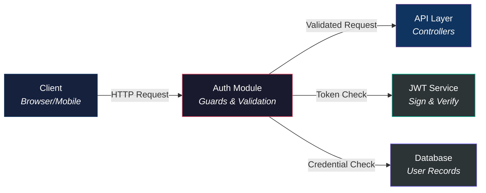

# Code Walkthrough Patterns — Reference

This file contains the exact patterns the agent must use when explaining code in deep-dive-withCode guides. The agent MUST read this file when operating in Mode 2 (Code Walkthrough).

---

## 1. The Golden Rule: Docs First, Code Second

Every code explanation must start with the documentation context. The pattern is:

```
DOCS (why) → CONCEPT (what) → ANALOGY (mental model) → CODE (how) → BREAKDOWN (details)
```

Never jump straight to code. The reader needs to understand WHY this code exists before they can understand what it does.

---

## 2. Key Function Walkthrough Pattern (Tier 1)

This is the full treatment for important functions. Use this for entry points, core business logic, complex algorithms, and critical integrations.

```markdown
### 2.3 Core Logic — `auth.service.ts` (L45-L62)
#### "The engine that validates credentials and mints tokens"

> **From the docs:** The authentication design doc specifies that the system uses
> bcrypt-hashed passwords with a fail-fast validation pattern. The service layer
> must remain HTTP-agnostic — it returns data, never HTTP responses.

**What this function does:** Takes an email and password, checks them against the
database, and returns the user object (without the password hash) if valid, or
`null` if invalid.

**Analogy:** Think of this function as a bank teller verifying your identity. You
hand over your ID (email) and signature (password). The teller checks the records
(database), compares your signature to the one on file (bcrypt.compare), and if
everything matches, gives you access to your account — but never hands back the
signature card itself (passwordHash is stripped).

```typescript
01: async validateUser(email: string, password: string): Promise<User | null> {
02:   const user = await this.userRepo.findOne({ where: { email } });  
03:   if (!user) return null;                                           
04: 
05:   const isMatch = await bcrypt.compare(password, user.passwordHash); 
06:   if (!isMatch) return null;                                         
07: 
08:   const { passwordHash, ...result } = user;                         
09:   return result;                                                     
10: }
```

**Grouped breakdown:**

| Line Range | What it does | Why (from docs/design) |
|------------|-------------|------------------------|
| **01 - 03** | Queries the DB for a matching user and triggers a fail-fast return | Uses TypeORM's `findOne` dynamically. If no user exists, returns `null` immediately, avoiding expensive bcrypt operations. |
| **05 - 06** | Validates credentials against storage | Compares plaintext password to stored bcrypt hashes asynchronously. Fail-fast design ensures incorrect passwords terminate the service early. |
| **08 - 10** | Sanitizes user data before returning | Destructures the user object to strip the sensitive passwordHash field. Spreads remaining properties into a safe object for the client. |

> [!NOTE]
> ### Cryptographic Validation — Bcrypt Hashing Under the Hood
> 
> Password verification is asynchronous and cryptographically isolated. The code `bcrypt.compare(password, user.passwordHash)` does not simply decrypt or compare text.
> 
> Here is what happens in the encryption runtime:
> 1. **Salt Extraction:** The stored `passwordHash` contains both the salt and the digest. Bcrypt parses the salt directly from the stored hash.
> 2. **Dynamic Re-hashing:** Bcrypt hashes the newly inputted plaintext `password` using that exact extracted salt.
> 3. **Timing-Safe Comparison:** It compares the newly generated hash digest with the stored hash in a **timing-safe** manner (preventing side-channel timing attacks), returning `true` only if they are identical.

> **Key Idea:** This function never throws for invalid credentials — it returns `null`.
> The controller decides the error response. This keeps the service layer HTTP-agnostic,
> as specified in the architecture doc.
```

---

## 3. Supporting Function Summary Pattern (Tier 2)

Use this for helpers, utilities, simple CRUD, and straightforward functions that don't need full walkthroughs.

```markdown
### 2.4 Supporting Functions

| Function | File | Purpose | Key Detail |
|----------|------|---------|------------|
| `formatDate(date)` | `utils/date.ts` | Converts Date to ISO string | Uses `toISOString()` with timezone offset |
| `sanitizeInput(str)` | `utils/sanitize.ts` | Strips HTML/script tags | Regex-based, called before all DB writes |
| `logError(err, ctx)` | `utils/logger.ts` | Structured error logging | Includes request ID for tracing |
| `hashPassword(plain)` | `auth/hash.ts` | Bcrypt hash with salt rounds | Uses 12 salt rounds per security doc |
| `generateId()` | `utils/id.ts` | Creates UUID v4 | Wraps `crypto.randomUUID()` |
```

---

## 4. Module Overview Pattern

Use this at the start of each module's PART to provide a bird's-eye view before diving into code.

```markdown
# PART 2 — Authentication Module

This module handles user identity — login, registration, token management, and route protection.
The architecture doc positions it as the gateway layer: nothing reaches the business logic
without passing through authentication first.

---

## 2.1 Purpose & Context
### "The bouncer at the door — verifying every visitor"

> **From the docs:** "The auth module implements a stateless JWT-based authentication
> system. All protected routes must validate tokens before processing requests.
> Token refresh is handled transparently to avoid session interruption."

**What this module is responsible for:**
- User registration and credential storage
- Login validation and JWT issuance
- Token refresh and expiration management
- Route protection via guards/middleware

**Where it sits in the architecture:**



## 2.2 Key Files

| File | Purpose | Key Exports |
|------|---------|-------------|
| `auth.controller.ts` | HTTP request handlers | `login()`, `register()`, `refresh()` |
| `auth.service.ts` | Core auth business logic | `validateUser()`, `generateToken()` |
| `auth.guard.ts` | Route protection middleware | `AuthGuard` class |
| `jwt.strategy.ts` | Passport JWT strategy | `JwtStrategy` class |
| `auth.module.ts` | NestJS module definition | `AuthModule` |

## 2.3 Dependencies

| This module uses | From module | For |
|-----------------|-------------|-----|
| `UserRepository` | Database/Models | Querying user records |
| `JwtService` | `@nestjs/jwt` | Signing and verifying tokens |
| `ConfigService` | Config | Reading JWT secret and expiration |
```

---

## 5. Discrepancy Flagging Pattern

When documentation and code disagree, always flag it:

```markdown
> [!WARNING]
> **Doc/Code Discrepancy:** The authentication design doc (Section 3.2) states that
> token expiration is set to 24 hours, but the code (`auth.service.ts:L78`) sets
> `expiresIn: '1h'`. The code is treated as the source of truth in this guide.
> **Action needed:** Update the design doc or the code to align.
```

**Rules for discrepancies:**
- Always cite the specific doc section and code file:line
- State which one this guide treats as truth (always the code)
- Suggest the action needed to resolve the mismatch
- Use the `[!WARNING]` callout, not `[!NOTE]`

---

## 6. File & Line Reference Pattern

When referencing code, always include the source:

```markdown
### `auth.service.ts` (L45-L62)
```

In inline text:
```markdown
The `validateUser()` function (`auth.service.ts:L45`) implements the fail-fast pattern...
```

**Rules:**
- Use backticks for filenames and function names
- Include line numbers when referencing specific code
- Use the format `filename:L{start}-L{end}` for ranges, `filename:L{line}` for single lines

---

## 7. Line Numbering System

Prepend each line of code inside a Tier 1 key function block with standard, two-digit line numbers (e.g., `01:`, `02:`, `03:`).

**Rules:**
- Prepend standard sequential line prefixes (`01:`, `02:`, `03:`) directly to the code block lines.
- Group these lines inside explanation tables using line ranges (e.g., `01 - 05`, `06 - 10`), describing 3-5 lines together in a single row.
- NEVER use circled numbers (①, ②, etc.) or write individual numbered paragraphs explaining them line-by-line.

---

## 7.1. Concept Callout Blocks

For complex, advanced, or vague code-level concepts (e.g., functional interfaces, asynchronous polling, loggers, or reflection), encapsulate them in a blue `> [!NOTE]` callout block immediately following the explanation table. Use this block to conceptually and technically deconstruct what the code does behind the scenes, using plain English and real code structures.

---

## 8. Analogy Pattern for Code

Even at the code level (Layer 3), provide analogies. These should be practical and relate to the function's behavior:

```markdown
**Analogy:** This middleware works like an airport security checkpoint. Every
passenger (request) must show their boarding pass (JWT token). Security (the guard)
doesn't care where you're going (which endpoint) — they just verify the pass is
valid and not expired. If it checks out, you proceed to your gate (controller).
If not, you're turned away (401 Unauthorized).
```

**Good code analogies focus on:**
- The function's role in the larger system
- The flow of data through the function
- Why certain checks or transformations happen

**Bad code analogies:**
- Explaining what an `if` statement is
- Comparing loops to abstract concepts
- Anything that explains basic programming, not the specific behavior

---

## 9. Cross-Reference Pattern

When code in one module depends on or calls code in another, cross-reference:

```markdown
> [!NOTE]
> This function calls `validateUser()` from the Auth Service (see [PART 2, Section 2.3](#23-core-logic--authservicets)).
> Understanding the validation flow first will make this controller logic clearer.
```

For multi-file guides:
```markdown
> [!NOTE]
> This function calls `validateUser()` from the Auth Service
> (see [Part2_ProjectName_AuthModule.md, Section 2.3](Part2_ProjectName_AuthModule.md#23-core-logic--authservicets)).
```
