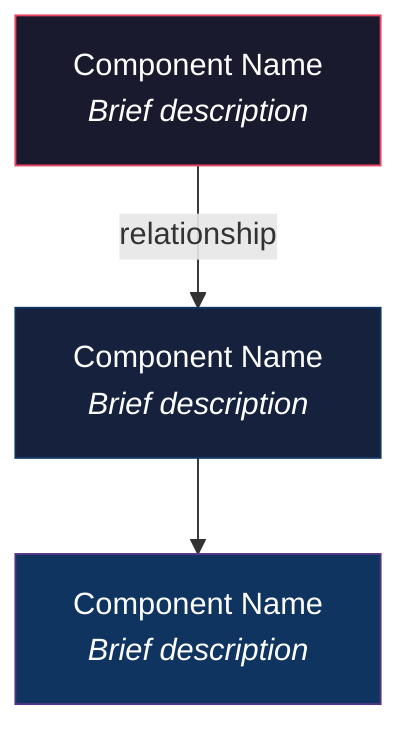
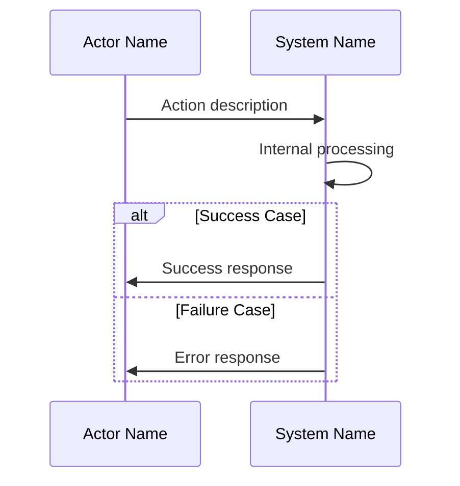
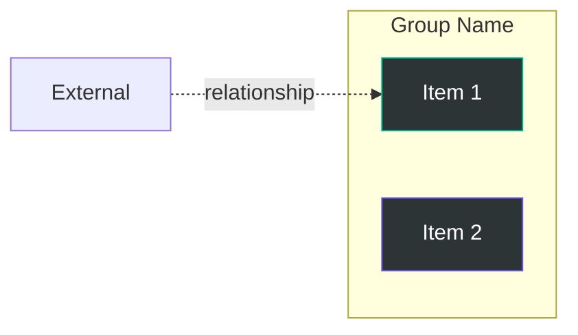

# Style Guide — Formatting Patterns Reference

This file contains the exact formatting patterns the deep-dive-docs skill should follow. These were extracted from high-quality documentation examples.

---

## 1. Title Block Pattern

```markdown
# [Topic] — Deep Dive Guide
### [Subtitle — a phrase describing the guide's angle]

---

> **How this guide fits:** [1-2 sentences on context / what it complements]

---
```

**Example:**
```markdown
# Docker Networking — Deep Dive Guide
### Understanding Container Communication from First Principles

---

> **How this guide fits:** Your existing Docker guide covers images, containers, and volumes.
> **This guide goes deeper** into networking — how containers talk to each other, to the host, and to the outside world.

---
```

---

## 2. Table of Contents Pattern

```markdown
## Table of Contents

1. [Section Title](#part-1--section-title-lowercase-dashed)
2. [Section Title](#part-2--section-title-lowercase-dashed)
3. [Section Title](#part-3--section-title-lowercase-dashed)
```

**Anchor rules:**
- Lowercase everything
- Replace spaces with `-`
- Remove special characters (except `-`)
- The em-dash `—` in `PART 1 — Title` becomes `--` in the anchor

---

## 3. PART Heading Pattern

```markdown
# PART 1 — [Title]

[Opening paragraph: 2-3 sentences framing what this part covers and why it matters]

---

## 1.1 [Concept Name]
### "[One-line plain-English essence in quotes]"

**The problem it solves:** ...

**What [Concept] does:**
- Bullet 1
- Bullet 2
- Bullet 3

**Analogy:** ...

[Technical content: code, tables, diagrams]

---
```

---

## 4. Comparison Table Pattern

Use this when comparing two or more concepts side-by-side:

```markdown
| | Concept A | Concept B |
|--|-----------|-----------|
| **Focus** | ... | ... |
| **Purpose** | ... | ... |
| **When to use** | ... | ... |
| **How** | ... | ... |
```

**Rules:**
- First column is the comparison dimension (bold)
- Left-align all text
- Keep cells concise (max 15 words per cell)

---

## 5. Reference/Data Table Pattern

Use this for structured reference information:

```markdown
| Name | Description | Example |
|------|-------------|---------|
| **Item 1** | What it is | `example` |
| **Item 2** | What it is | `example` |
```

---

## 6. Mermaid Diagram Patterns

### 6a. Architecture / Component Graph


### 6b. Sequence Diagram (Process Flow)


### 6c. Subgraph Pattern (Grouping)


**Color palette to use:**
| Purpose | Fill | Stroke |
|---------|------|--------|
| Primary nodes | `#1a1a2e` | `#e94560` |
| Secondary nodes | `#16213e` | `#0f3460` |
| Tertiary nodes | `#0f3460` | `#533483` |
| Success/positive | `#2d3436` | `#00b894` |
| Highlight/accent | `#2d3436` | `#6c5ce7` |

---

## 7. ASCII Art Patterns

### 7a. Tree Structure
```
Animal (name, age, sleep)
  ├── Dog (adds: fetch, bark)
  └── Cat (adds: purr, climb)
```

### 7b. Flow Diagram
```
┌──────┐    ┌──────┐    ┌───────┐    ┌────────┐
│ Step1│ ──→│ Step2│ ──→│ Step3 │ ──→│ Step4  │
└──────┘    └──────┘    └───────┘    └────────┘
```

### 7c. Diamond / Multi-path
```
    A
   / \
  B   C
   \ /
    D
```

**Use ASCII when:**
- The structure is very simple (< 5 nodes)
- Showing a quick inline reference that doesn't warrant a full diagram
- Showing directory structures

**Use Mermaid when:**
- The structure has > 5 nodes or complex relationships
- You need color-coding
- Showing sequential/temporal flows

---

## 8. Code Snippet Pattern

```markdown
```[language]
// Brief comment explaining what this shows
[code here — 5-20 lines ideal]
```                                          
```

**Rules:**
- Always specify language: `python`, `bash`, `yaml`, `javascript`, `cpp`, `json`, etc.
- Add inline comments for non-obvious lines
- If showing both input AND output, use separate code blocks:

```markdown
```bash
# Command
docker network ls
```

**Output:**
```
NETWORK ID     NAME      DRIVER    SCOPE
abc123         bridge    bridge    local
def456         host      host      local
```
```

---

## 9. Callout Patterns

### Key Idea (use for the #1 takeaway of a section)
```markdown
> **Key Idea:** [One-sentence core insight]
```

### Important (use for must-not-miss information)
```markdown
> [!IMPORTANT]
> [Critical detail the reader needs to know]
```

### Note (use for supplementary context)
```markdown
> [!NOTE]
> [Helpful background or "good to know" information]
```

---

## 10. Concept Introduction Pattern

This is the standard way to introduce a new concept:

```markdown
## [Number].[Sub] [Concept Name]
### "[Plain-English one-liner summary]"

**The problem it solves:** [2-3 sentences describing the pain point this addresses]

**What [Concept] does:**
- [Bullet 1 — core mechanism]
- [Bullet 2 — key feature]
- [Bullet 3 — key feature]

**Analogy:** [Real-world comparison that makes it click]

[Then: technical details, tables, code, diagrams as needed]

> **Key Idea:** [Single most important takeaway]

---
```
