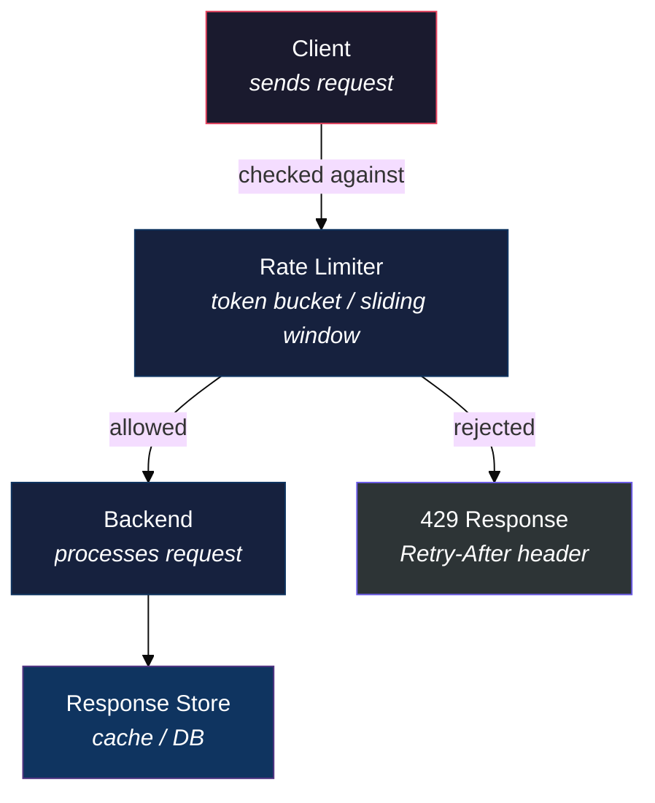

# Full Worked Example — Tier 3 Document

This is a complete (if short) Tier 3 document showing every pattern from `style_guide.md` composed together, so structure doesn't drift when assembling a longer real one. Everything past the `===` line below is the actual example document, verbatim as it should be produced.

Note in particular: single H1, explicit anchors, H2 PARTs, role-based Mermaid colors, the concept-intro template used once (not stamped on every subsection), a collapsible for optional depth, and the footer.

===

# Rate Limiting — Deep Dive Guide
### Protecting APIs from Abuse Without Punishing Real Users

---

> **How this guide fits:** Your API design guide covers routing and auth. This guide goes deeper into rate limiting — the algorithms, where to enforce them, and the trade-offs between accuracy and cost.

---

## Table of Contents

1. [Why Rate Limit](#part-1)
2. [Algorithms](#part-2)

---

<a id="part-1"></a>
## PART 1 — Why Rate Limit

Every public API eventually meets a client that calls it far more than intended — a retry loop gone wrong, a scraper, or a genuine spike in demand. Rate limiting is the mechanism that keeps one client's behavior from degrading service for everyone else.

### 1.1 What Rate Limiting Actually Protects

#### "A speed bump, not a wall"

**The problem it solves:** without a limit, a single misbehaving client can exhaust shared resources — database connections, CPU, downstream API quotas — degrading the service for every other client.

**What rate limiting does:**
- Caps how many requests a client can make in a given window
- Returns a fast, cheap rejection (`429 Too Many Requests`) instead of a slow failure
- Buys the backend headroom to stay responsive under load

**Analogy:** it's a bouncer at a door with a fixed capacity — not blocking people out of dislike, just pacing the flow so the room doesn't overflow.

> **Key Idea:** Rate limiting trades a small amount of friction for every client against protecting the service for all clients.

---

<a id="part-2"></a>
## PART 2 — Algorithms

Different algorithms make different trade-offs between memory cost, burst tolerance, and accuracy. The diagram below shows where each one sits relative to a request.



### 2.1 Common Algorithms Compared

| | Fixed Window | Sliding Window | Token Bucket |
|--|---------------|-----------------|---------------|
| **Burst tolerance** | Allows bursts at window edges | Smooths edge bursts | Allows configurable bursts |
| **Memory cost** | Lowest | Higher | Low |
| **Accuracy** | Approximate | Accurate | Accurate for average rate |
| **When to use** | Simple, low-stakes limits | Precise per-user limits | APIs wanting burst + steady rate |

<details>
<summary><strong>Click to expand: Token bucket reference implementation</strong></summary>

```python
# Minimal token bucket — refills at a fixed rate, allows bursts up to capacity
class TokenBucket:
    def __init__(self, capacity: int, refill_rate: float):
        self.capacity = capacity
        self.tokens = capacity
        self.refill_rate = refill_rate  # tokens per second
        self.last_check = time.monotonic()

    def allow(self) -> bool:
        now = time.monotonic()
        elapsed = now - self.last_check
        self.tokens = min(self.capacity, self.tokens + elapsed * self.refill_rate)
        self.last_check = now
        if self.tokens >= 1:
            self.tokens -= 1
            return True
        return False
```

</details>

> [!IMPORTANT]
> Always return a `Retry-After` header on `429` responses — it's the difference between a client backing off gracefully and a client retrying immediately into another rejection.

Rollout checklist for adding a limiter to an existing API:

- [ ] Pick the algorithm based on burst tolerance needs (§2.1)
- [ ] Decide the limit key (per-IP, per-API-key, per-user)
- [ ] Add `Retry-After` to rejection responses
- [ ] Load-test at 2x expected peak before shipping

---

*Scope: rate limiting algorithms and enforcement points for HTTP APIs.*
