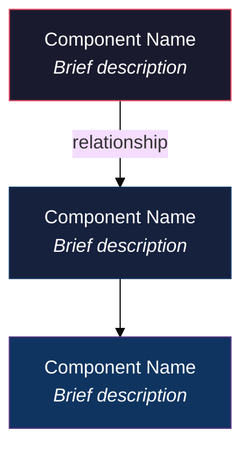
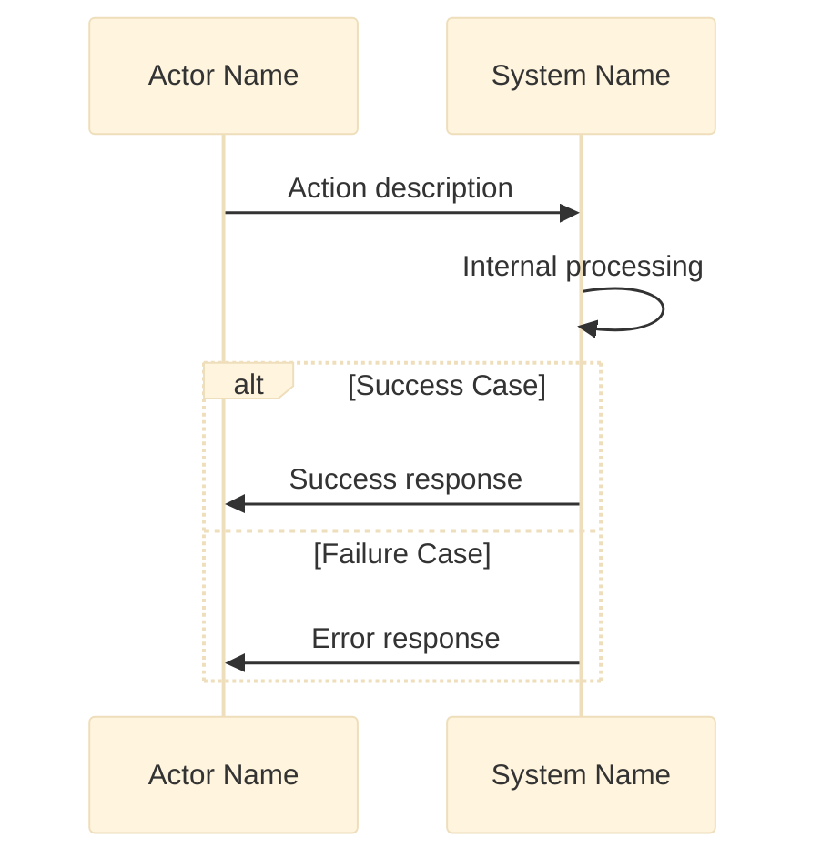
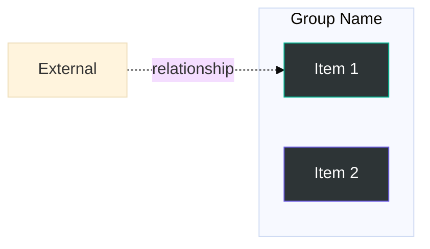
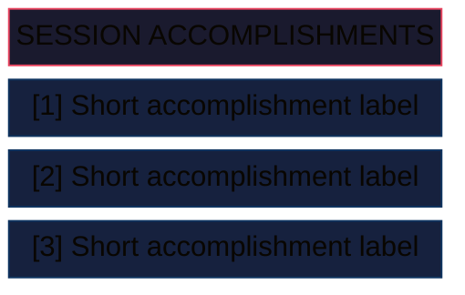
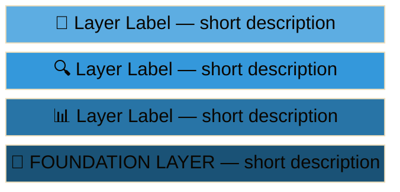

# Style Guide — Formatting Patterns Reference

Exact formatting patterns the merC skill follows. **v3 changelog:** added LaTeX/math support (§17); version tags normalized to one line, no per-section tags.

---

## 1. Title Block Pattern (Tier 2/3)

```markdown
# [Topic] — Deep Dive Guide
### [Subtitle — a phrase describing the guide's angle]

---

> **How this guide fits:** [1-2 sentences on context / what it complements]

---
```

**Example:**
```markdown
# Docker Networking — Deep Dive Guide
### Understanding Container Communication from First Principles

---

> **How this guide fits:** Your existing Docker guide covers images, containers, and volumes.
> **This guide goes deeper** into networking — how containers talk to each other, to the host, and to the outside world.

---
```

---

## 2. Table of Contents Pattern

```markdown
## Table of Contents

1. [Section Title](#part-1)
2. [Section Title](#part-2)
3. [Section Title](#part-3)
```

Each linked heading carries its own explicit anchor immediately above it:

```markdown
<a id="part-1"></a>
## PART 1 — Section Title
```

**Why explicit anchors instead of auto-slugged links:** auto-generated anchors (lowercase, spaces→hyphens, punctuation stripped) are computed differently by GitHub, VS Code's preview, Obsidian, and static site generators — they will not agree on a heading containing an em-dash or colon. An explicit `<a id="...">` tag is unambiguous everywhere. Use short sequential ids (`part-1`, `part-2`, `part-2-1` for a subsection) — the id doesn't need to encode the title, the ToC link text already does that.

---

## 3. PART Heading Pattern

```markdown
<a id="part-1"></a>
## PART 1 — [Title]

[Opening paragraph: 2-3 sentences framing what this part covers and why it matters]

---

### 1.1 [Concept Name]
#### "[One-line plain-English essence in quotes]"

**The problem it solves:** ...

**What [Concept] does:**
- Bullet 1
- Bullet 2
- Bullet 3

**Analogy:** ...

[Technical content: code, tables, diagrams]

---
```

Only the document title is H1. This keeps a single semantic outline root and prevents ToC/linter tools that assume one-H1-per-document from misreading the structure.

> Use the full concept-introduction template (problem → what it does → analogy) for the *first* time a genuinely new, non-trivial concept appears. For minor or supporting concepts, a tight paragraph is enough — don't stamp the full template on every subsection just for consistency's sake.

---

## 4. Comparison Table Pattern

**Default trigger:** comparing ≥2 named items across ≥2 shared attributes → this is a table, not a judgment call. Don't downgrade this shape to bullets or prose.

```markdown
| | Concept A | Concept B |
|--|-----------|-----------|
| **Focus** | ... | ... |
| **Purpose** | ... | ... |
| **When to use** | ... | ... |
| **How** | ... | ... |
```

**Rules:**
- First column is the comparison dimension (bold).
- Left-align all text.
- Keep cells concise (max 15 words per cell). If a cell's reasoning genuinely needs more room, that content belongs in the Decision/Options pattern (§15) instead — don't cram it in or drop the table for the rest of the data.

---

## 5. Reference/Data Table Pattern

**Default trigger:** listing ≥3 structured records with shared fields (parameters, configs, endpoints, mappings) → this is a table.

```markdown
| Name | Description | Example |
|------|-------------|---------|
| **Item 1** | What it is | `example` |
| **Item 2** | What it is | `example` |
```

---

## 6. Mermaid Diagram Patterns

Every diagram opens with a theme directive so custom fills render consistently instead of getting overridden by a viewer's default theme:

```
%%{init: {'theme':'base'}}%%
```

### 6a. Architecture / Component Graph


### 6b. Sequence Diagram (Process Flow)


### 6c. Subgraph Pattern (Grouping)


**Color roles** — pick by what the node *is*, not by its position in the diagram:

| Role | Fill | Stroke | Use for |
|------|------|--------|---------|
| Primary / entry point | `#1a1a2e` | `#e94560` | actors, entry nodes |
| Core / process | `#16213e` | `#0f3460` | main processing steps |
| Data / storage | `#0f3460` | `#533483` | databases, caches, state |
| Success / output | `#2d3436` | `#00b894` | success paths, results |
| External / accent | `#2d3436` | `#6c5ce7` | external systems, warnings |

A 20-node diagram where color maps to role (all databases are the same color, all external systems are the same color) reads far more clearly than one where colors just cycle A→B→C→D→E→A.

### 6d. Brackets & Special Characters Protection
Never place raw square brackets `[]` or nested parentheses `()` directly inside unquoted node labels (e.g., `Node([Data [Box]])`). This confuses the Mermaid parser, breaking the compilation and causing rendering failures. 

To resolve this, **always wrap the entire label inside double quotes** within the parenthesized shapes:


---

## 7. ASCII Art Patterns

> [!IMPORTANT]
> The full bordered container (`┌─...─┐` wrapping any number of content rows, closed with `└─...─┘`) is **retired**. It has broken in real use twice — once with paragraph content, once with a plain list of short one-liners. The failure isn't about content length: this skill's rendering environment doesn't reliably preserve fixed-width monospace alignment for a right-hand border repeated across rows. No amount of "only for short content" scoping fixes that, so the pattern is gone, not narrowed further.

### 7a. Tree Structure (kept — no closing right border, structurally low-risk)
```
Animal (name, age, sleep)
  ├── Dog (adds: fetch, bark)
  └── Cat (adds: purr, climb)
```
Fine for directory structures and small parent/child sketches — there's no right-hand border that needs to line up, so it doesn't share the failure mode above.

### 7b. Flow Diagram — **retired**
Use a small Mermaid diagram instead, even for 2–3 steps:


### 7c. Diamond / Multi-path (kept, minimal risk — small structural sketches only)
```
    A
   / \
  B   C
   \ /
    D
```

---

**Decision rule — what to use instead of a box:**

| Content shape | Use |
|----------------|-----|
| Flat, equal-weight short items, no visual containment needed | Plain Markdown list — no box at all |
| Same, but you want a visually distinct "card" look (recap, key takeaways, session summary) | `block-beta`, single solid fill, `columns 1` (§16) |
| Genuine hierarchy or layered stack | `block-beta` with gradient fill (§16) |
| Directory structure | ASCII tree (7a) |
| Any linear or branching flow | Mermaid `graph`/`flowchart` (§6), not ASCII boxes |

---

## 8. Code Snippet Pattern

````markdown
```[language]
// Brief comment explaining what this shows
[code here — 5-20 lines ideal]
```
````

**Rules:**
- Always specify language: `python`, `bash`, `yaml`, `javascript`, `cpp`, `json`, etc.
- Add inline comments for non-obvious lines.
- If showing both input AND output, use separate code blocks:

````markdown
```bash
# Command
docker network ls
```

**Output:**
```
NETWORK ID     NAME      DRIVER    SCOPE
abc123         bridge    bridge    local
def456         host      host      local
```
````

---

## 9. Callout Patterns

### Key Idea (use for the #1 takeaway of a section)
```markdown
> **Key Idea:** [One-sentence core insight]
```

### Important (use for must-not-miss information)
```markdown
> [!IMPORTANT]
> [Critical detail the reader needs to know]
```

### Note (use for supplementary context)
```markdown
> [!NOTE]
> [Helpful background or "good to know" information]
```

---

## 10. Concept Introduction Pattern

Default for the **first appearance of a genuinely new, non-trivial concept** — not a mandatory template for every subsection (see §3 note above).

```markdown
### [Number].[Sub] [Concept Name]
#### "[Plain-English one-liner summary]"

**The problem it solves:** [2-3 sentences describing the pain point this addresses]

**What [Concept] does:**
- [Bullet 1 — core mechanism]
- [Bullet 2 — key feature]
- [Bullet 3 — key feature]

**Analogy:** [Real-world comparison that makes it click]

[Then: technical details, tables, code, diagrams as needed]

> **Key Idea:** [Single most important takeaway]

---
```

---

## 11. Collapsible Sections

For genuinely optional/supplementary content only: full config dumps, verbose logs, appendices, rarely-needed reference material.

```markdown
<details>
<summary><strong>Click to expand: Full config example</strong></summary>

[content — code, tables, prose]

</details>
```

**Never use for:**
- Primary code examples — the code the reader actually asked about or needs to follow the explanation
- Class/method skeletons that are part of the main teaching content, not an aside
- Anything referenced or built on by later text in the document — if the reader has to expand it to keep following, it shouldn't be collapsed

**Default is uncollapsed.** Only collapse when secondary material (rule of thumb: 40+ lines) would otherwise overwhelm the main reading flow. When unsure, don't collapse it.

---

## 12. Task Lists

For setup steps, migration checklists, or anything the reader will work through and check off:

```markdown
- [ ] Step not yet done
- [x] Step completed
```

---

## 13. Footnotes

For citations or asides that would clutter the inline flow of a sentence:

```markdown
The behavior changed in the 2.0 release.[^1]

[^1]: See the migration guide for the full list of breaking changes.
```

Use sparingly — most asides read better as a `[!NOTE]` callout than a footnote.

---

## 14. Footer Metadata

End of a deep-dive document:

```markdown
---
*Scope: [what this document covers] · [optional: version/source/date]*
```

Keep it to one line — it's a wayfinding note, not a changelog.

---

## 15. Decision/Options Framework

For "here are N alternatives, each with reasoning" content — proposal options, mitigation strategies, trade-off discussions. This is the pattern that replaces boxed ASCII art or a table when each item is prose-length rather than a short label, and the items are **mutually exclusive alternatives**, not a hierarchy (if they're a hierarchy, use §16 instead).

```markdown
#### Option A — [Short Label]
[1–3 sentences: what this option does and its main trade-off.]

#### Option B — [Short Label]
[1–3 sentences.]

#### Option C — [Short Label] *(recommended)*
[1–3 sentences.]
```

**Rules:**
- H4 for each option header — sits clearly under a PART/subsection (H2/H3) without competing with them.
- Bold isn't necessary on the header line; the H4 already carries the visual weight.
- Mark a recommendation inline with `*(recommended)*`, not a separate callout — keeps the options visually parallel.
- If each option genuinely reduces to a single short phrase (not sentences), use a comparison table (§4) instead — this pattern is specifically for when the reasoning needs room to breathe.
- Never put this content in a box-drawing ASCII block (§7) — prose-length text breaks fixed-width alignment.

**Example (from a risk-mitigation proposal):**
```markdown
#### Option A — Tighten Gateway Validation
Implement strict validation filters inside the REST gateway controllers to actively verify URL schemas, CronTab syntax, and parameter values.

#### Option B — Update LLD Document
If the development team asserts that these parameters can remain optional, we must formally update the LLD. Tests will then assert "201 Created".

#### Option C — Hybrid Compromise *(recommended)*
Enforce strict gatekeeping only on critical fields that cause Master crashes (e.g. CronTab syntax & metadata templates) while remaining lenient on secondary strings.
```

---

## 16. Block Diagrams (`block-beta`)

Two distinct uses, both replacing the retired bordered-box container (§7):

**A — Flat list / recap card** (equal-weight items, no hierarchy — e.g. a session summary, key takeaways, accomplishments list):


Single solid fill (plus a distinct header block) — no gradient, since nothing here is more "fundamental" than anything else. If the list has no need for visual containment at all, a plain Markdown list is simpler and just as valid; reach for this only when the "card" look is actually wanted.

**B — Hierarchy or layered stack** (an abstraction pyramid, a maturity ladder, system layers):


Top-to-bottom color gradient (darkest at the foundation, lightest at the top) reads as "more fundamental → more abstract."

**Rules for both:**
- Keep each block label short — a few words plus an optional brief description. `block-beta` doesn't wrap long text gracefully; treat it the same as a Mermaid node, not a text container. (Paragraph-length reasoning still belongs in the Decision/Options pattern, §15.)
- `columns 1` for a vertical stack; use `columns N` only for genuine grid layouts.
- Not for content with paragraph-length reasoning per item — that's still §15, not this.

> [!NOTE]
> `block-beta` is a newer, beta-status Mermaid diagram type. It renders on GitHub and the Mermaid Live Editor, but support in VS Code's preview, Obsidian, and static-site generators can lag behind the core `graph`/`flowchart` syntax. Given the bordered-box ASCII pattern has now failed twice in real use, this is the recommended default regardless — if it turns out unsupported in your specific renderer, fall back to a plain Markdown list, not back to ASCII boxes.


---

## 17. LaTeX Math

Use when a formula meets the trigger in SKILL.md §2.9 (fractions, sums/integrals, roots, sub/superscripts, Greek, matrices, derivations). Trivial expressions stay plain.

**Inline:** `$\bar{x} = \frac{1}{n}\sum_{i=1}^{n} x_i$`

**Block (preferred, works everywhere including lists and callouts):**

````markdown
```math
\hat{y} = \sigma(Wx + b) = \frac{1}{1 + e^{-(Wx + b)}}
```
````

**Block (top level only):**

```markdown
$$
\int_0^\infty e^{-x^2}\,dx = \frac{\sqrt{\pi}}{2}
$$
```

**Multi-step derivation:** use `aligned` so the `=` signs line up.

````markdown
```math
\begin{aligned}
\text{Var}(X) &= E[(X-\mu)^2] \
              &= E[X^2] - \mu^2
\end{aligned}
```
````

**Text inside math:** use `\text{...}`, not bare words, so spacing is correct (`$\text{rate} = \frac{k}{n}$`).

**Placement rules:**
- Callouts and lists: ```` ```math ```` fence only. Multi-line `$$` breaks inside `>` quotes and list items.
- Tables: no bare `|`; use `\lvert x \rvert`, `\mid`, `\Vert`. Keep cells short; move long formulas out to a block under the table.
- Mermaid labels: no LaTeX. Use Unicode (`α`, `Σ`, `x²`).
- Currency: escape as `\$` (`costs \$5`); an unescaped pair of `$` becomes math.
- Underscores and asterisks inside `$...$` are safe in GitHub, VS Code, and Obsidian; if a renderer mangles them, wrap the formula in a ```` ```math ```` fence instead.
- Define symbols in a short sentence before or after a block formula ("where $n$ is the sample size").
- Fallback if a viewer shows raw LaTeX: it stays readable, but do not rely on it for the only statement of a result; pair key results with a plain-text sentence.
