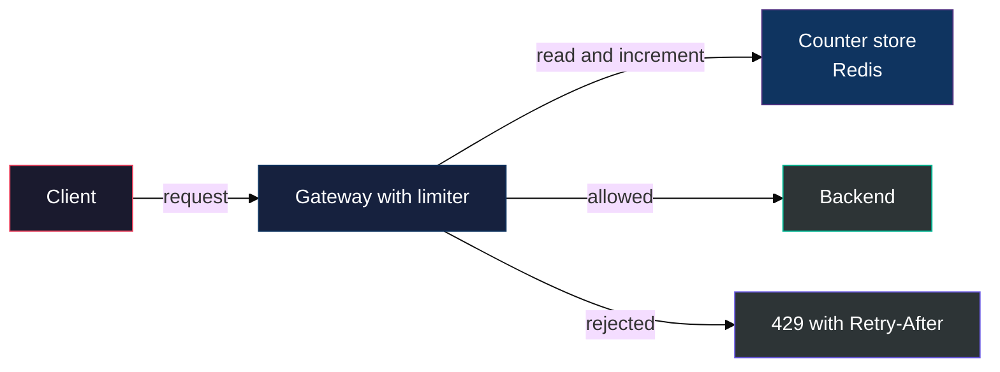
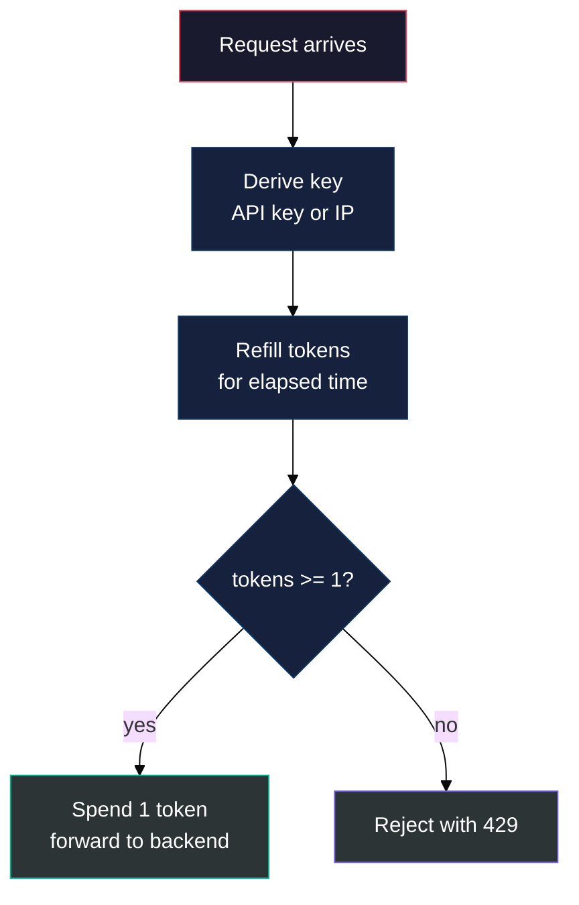

# Full Worked Example — Tier 3 Document (v6)

A complete Tier 3 document in the v6 format. Everything past the `===` line is the example, verbatim as it should be produced.

What it demonstrates:
- 7 reader questions, so Tier 3
- question headings under noun-label PARTs
- one slot template per question
- `→` implications and the word caps
- visuals that fire only on section 3.1 triggers
- no subtitle, lead-ins or footer

For a v5 → v6 comparison of the same section, see style_guide.md section 10.

===

# Rate Limiting

---

## Table of Contents

1. [Basics](#part-1)
   - [What does a rate limiter protect?](#part-1-1)
   - [Where does the limiter sit?](#part-1-2)
2. [Algorithms](#part-2)
   - [Which algorithm should I use?](#part-2-1)
   - [How many tokens does a bucket hold?](#part-2-2)
   - [How is a request checked?](#part-2-3)
3. [Operations](#part-3)
   - [What should a rejection return?](#part-3-1)
   - [How do I roll it out?](#part-3-2)

---

<a id="part-1"></a>
## PART 1 — Basics

<a id="part-1-1"></a>
### 1.1 What does a rate limiter protect?

**Definition:** a cap on requests per client per time window.
**Parts:** `limiter = key + limit + window + rejection`
- **Key** — who is counted: IP, API key, or user
- **Limit + window** — e.g. 100 requests per 60 s
- **Rejection** — fast `429` instead of a slow failure
**Implications:**
- One client can't exhaust shared DB/CPU → others stay responsive
- Rejection is cheap → backend keeps headroom during spikes

<a id="part-1-2"></a>
### 1.2 Where does the limiter sit?



**What:** a check in the gateway that runs before any backend work.
**Responsibility:**
- Derive the client key from each request
- Count requests in a shared store
- Forward or reject
**In → Out:** `request` → `forwarded request` or `429`
**Depends on:** shared counter store (Redis)
**Implications:**
- Counters live in Redis, not gateway memory → limits hold across gateway replicas
- Redis down → choose fail-open (no limits) or fail-closed (reject all)

> **Key Idea:** Enforce limits at the edge, so rejected requests never consume backend capacity.

---

<a id="part-2"></a>
## PART 2 — Algorithms

<a id="part-2-1"></a>
### 2.1 Which algorithm should I use?

**Context:** algorithms trade memory, burst tolerance, and accuracy.
**Options:**

| | Fixed Window | Sliding Window | Token Bucket |
|--|--------------|----------------|--------------|
| **Bursts** | Doubles at window edges | Smoothed | Allowed up to capacity |
| **Memory** | 1 counter | Log or 2 counters | 2 numbers |
| **Accuracy** | Approximate | Accurate | Accurate for average rate |

**Pick:** token bucket — steady rate plus controlled bursts at near-zero memory.
**Cost:** two parameters to tune instead of one.

<a id="part-2-2"></a>
### 2.2 How many tokens does a bucket hold?

**Definition:** tokens refill at a fixed rate up to a capacity; each request spends one.
**Parts:** with capacity $C$, refill rate $r$ per second, and $T_0$ tokens left after the last check:

```math
T(\Delta t) = \min\left(C,\; T_0 + r\,\Delta t\right)
```

**Implications:**
- Sustained rate is bounded by $r$ → set $r$ to the long-run limit
- Burst size is bounded by $C$ → set $C$ to the largest acceptable spike
**Example:**

<details>
<summary><strong>Click to expand: Token bucket reference implementation</strong></summary>

```python
import time

class TokenBucket:
    def __init__(self, capacity: int, refill_rate: float):
        self.capacity = capacity
        self.tokens = capacity
        self.refill_rate = refill_rate  # tokens per second
        self.last_check = time.monotonic()

    def allow(self) -> bool:
        now = time.monotonic()
        # Refill for the time elapsed since the last check, capped at capacity
        self.tokens = min(self.capacity, self.tokens + (now - self.last_check) * self.refill_rate)
        self.last_check = now
        if self.tokens >= 1:
            self.tokens -= 1
            return True
        return False
```

</details>

<a id="part-2-3"></a>
### 2.3 How is a request checked?

**Trigger:** a request reaches the gateway.
**Steps:**



**Output:** request forwarded, or `429` returned.
**Failure points:**
- Refill and spend not atomic → concurrent requests overspend tokens
- Key falls back to IP → users behind one NAT share a limit

---

<a id="part-3"></a>
## PART 3 — Operations

<a id="part-3-1"></a>
### 3.1 What should a rejection return?

- Status `429 Too Many Requests`
- `Retry-After` header → clients back off instead of retrying instantly
- `RateLimit-Remaining` header → clients can pace themselves before hitting the limit

> [!IMPORTANT]
> Missing `Retry-After` turns one rejection into a retry storm.

<a id="part-3-2"></a>
### 3.2 How do I roll it out?

**Trigger:** adding a limiter to an existing API.
**Steps:**
1. Run in log-only mode → see who would be limited
2. Set $C$ and $r$ from observed peak traffic
3. Enforce, then load-test at 2x expected peak
**Output:** enforced limits that don't block known-good clients.
