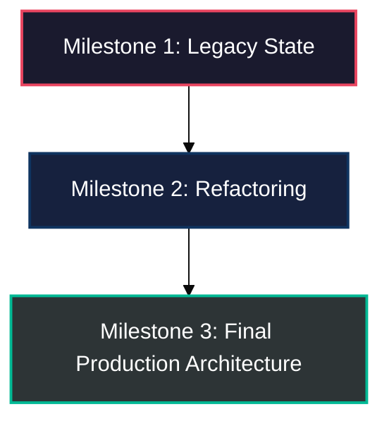

# Master Findings Patterns & Synthesis Reference

This guide details the structural patterns, Roman numeral naming conventions, and decision rules for creating or appending to Master Findings files in `docs/sessions/master_findings/`.

---

## 1. Core Philosophy: Master Knowledge vs. Raw Logs

Raw session logs are transient and progressive; they naturally contain trial-and-error attempts, outdated assumptions, temporary test failures, and superseded code. Over time, these files become "poison context" for AI agents and confusing for engineers.

**Master Findings** solve this by extracting only **purified, verified, and long-term architectural truth**:
1. **Zero Toxic Context:** Strip away failed experiments and false leads unless they represent a vital discovery/gotcha.
2. **High-Signal Synthesis:** Focus on *why* decisions were made, *how* architecture evolved, and *what* patterns are permanently enforced.
3. **Enterprise Aesthetic (`merc`):** Structured markdown with metadata callouts, Mermaid architecture graphs, concise contrast tables, and production-tested snippets.

---

## 2. Decision Matrix: Append vs. Create New Roman Numeral

When reviewing active sessions to wrap and archive, evaluate each topic against this matrix:

| Factor | Append to Existing Master File | Create New Roman Numeral File |
| :--- | :--- | :--- |
| **Domain Scope** | Directly extends an established theme already represented in `master_findings/`. | Introduces a new architectural pillar, a distinct subsystem, or a major new feature domain. |
| **Volume & Length** | Delta is compact (under ~100 lines) and fits cleanly into existing sections. | Substantial new content (>100 lines) that would make an existing master file unwieldy (>250 lines). |
| **Milestone Phasing** | Ongoing minor iterations or bugfix alignments. | Natural evolution / Part 2 / Part 3 milestone (e.g., `V_Journey_of_API_Implementations_Part2.md`). |

### Roman Numeral Sequencing
When creating new files:
1. Scan `docs/sessions/master_findings/` for all existing prefixes: `I_`, `II_`, `III_`, `IV_`, `V_`, `VI_`, etc.
2. Determine the highest existing Roman numeral index.
3. Increment sequentially:
   - If highest is `VI`, the next is `VII_Journey_of_[Domain].md`.
   - If `master_findings/` is empty or new, start at `I_Journey_of_[Domain].md`.

---

## 3. Master Findings Document Architecture

Every Master Findings file must follow this structural layout:

### A. Title Block & Metadata Callout
```markdown
# [Roman]. Journey of [Domain / Theme]
### [Subheading describing the technical evolution and scope]

> **Scope:** [Module / Repository Domain]  
> **Audience:** [Engineering / QA Team]  
> **Status:** Finalized & Validated  

---
```

### B. Table of Contents
```markdown
## Table of Contents
1. [Introduction](#1-introduction)
2. [Chronological Architecture Milestones](#2-chronological-architecture-milestones)
3. [Core Technical Pillar / Pattern](#3-core-technical-pillar--pattern)
...
```

### C. Milestone Topology Diagram (Mermaid)
Provide a visual progression showing how the architecture or feature evolved:
```markdown

```

### D. Problem vs. Solution Contrast Table
Synthesize before/after technical shifts into clean tables:
```markdown
| Scenario / Challenge | Legacy / Buggy Behavior | Refactored Architecture | Impact / Guarantee |
| :--- | :--- | :--- | :--- |
| **Validation Gap** | Permissive 200 OK returned on invalid cron | Strict schema enforcement or tracked leniency bypass | Zero false test passes |
```

### E. Golden Snippets & Logic Mechanics
Include minimal, self-contained snippets representing the final pattern (e.g., thread-safe teardown queues, Awaitility polling constructs, or REST specification builders).

---

## 4. Appending to Existing Master Files

When appending:
1. Identify the matching target file in `docs/sessions/master_findings/`.
2. Determine the next logical numbered section header (e.g., `## 7. [New Section Title]`).
3. Add an entry to the document's Table of Contents at the top.
4. Ensure all cross-references and anchor links match GitHub-flavored Markdown standards.
